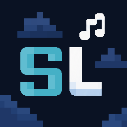
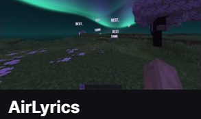
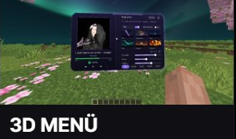
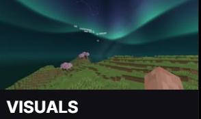

<p align="center">
  
</p>

<h1 align="center">🎵 SkyLyrics</h1>

<p align="center">
  <strong>Live synchronized 3D song lyrics for Minecraft</strong><br>
  <em>Fabric · Minecraft 1.21.11 · Java 21</em>
</p>

<p align="center">
  
  
  
  
  
</p>

---

## 📖 About

**SkyLyrics** brings your favorite music directly into Minecraft with real-time synchronized song lyrics from Spotify and YouTube. Watch lines glow across the sky or float smoothly as 3D holographic text around you with customizable neon themes and beat pulsing. It works completely out of the box with zero setup required—just play your music and enjoy!

---

## ✨ Features

| Feature | Description |
| :--- | :--- |
| 🌌 **3D Air & Sky Lyrics** | Lyrics projected onto the celestial dome or floating in 3D space around you |
| 🎧 **Zero-Config Media Sync** | Automatically detects playback from Spotify Desktop, YouTube, and any Windows media player (SMTC) |
| ⏱️ **Word-by-Word Karaoke** | High-precision word-level synchronization with musical beat pulsing |
| 🎨 **Neon Themes** | 20+ built-in presets (Neon Pink, Ice Blue, Sunset, Matrix, Aurora, Vaporwave, and more) or fully custom palettes |
| ✏️ **Custom Fonts** | Drop any `.ttf` font into the config folder and use it instantly |
| 🌠 **Sky Effects** | Twinkling stars, floating light motes, and falling streaks while music plays |
| 🎚️ **Dynamic Island Top Bar** | Song title, artist, and live lyrics in a sleek top-of-screen pill |
| 🖥️ **HUD Music Player** | On-screen player with cover art, progress bar, and playback controls |
| ⚡ **Performance Friendly** | Ultra-lightweight rendering pipeline, compatible with Sodium and Iris shaders |
| 🕳️ **Underground Mode** | Lyrics remain visible through blocks when you're in caves |
| 🔊 **Volume Control** | Control Spotify volume directly from in-game |

---

## 🎮 Controls

| Key | Action |
| :--- | :--- |
| **K** | Open the SkyLyrics settings dashboard |
| **J** | Open the HUD music player |
| **O** | Toggle SkyLyrics on / off |
| **↓** | Play / Pause playback |
| **→** | Next track |
| **←** | Previous track |
| **[** | Nudge lyrics earlier (-100 ms) |
| **]** | Nudge lyrics later (+100 ms) |

All keybinds are fully remappable in the dashboard or via Minecraft's standard Controls menu.

---

## 📦 Installation

1. Install [Fabric Loader](https://fabricmc.net/use/) (>= 0.17.0, tested with 0.19.5) for **Minecraft 1.21.11**
2. Install [Fabric API](https://modrinth.com/mod/fabric-api) (0.141.6+1.21.11)
3. Download the latest mod jar from the [GitHub Releases](https://github.com/lukaseschn-design/SkyLyrics-Source-code/releases/tag/v1.0%2B1.21.11) page (or from `releases/SkyLyrics-v1.0+1.21.11.jar`)
4. Drop it into your `.minecraft/mods` folder
5. Launch the game, play any song on Spotify or YouTube, and enjoy!

### Requirements

- Minecraft **1.21.11**
- Fabric Loader **>= 0.17.0**
- Fabric API **0.141.6+1.21.11**
- Java **21+**
- Windows 10 / 11 (for automatic media detection via SMTC)

### Optional (Recommended)

- [Mod Menu](https://modrinth.com/mod/modmenu) — for easy access to the in-game configuration screen
- [Sodium](https://modrinth.com/mod/sodium) — fully compatible, runs great together

---

## 🔨 Building from Source

You can build SkyLyrics directly using the included Gradle wrapper:

```bash
git clone https://github.com/lukaseschn-design/SkyLyrics-Source-code.git
cd SkyLyrics-Source-code
./gradlew build
```

The resulting mod JAR will be placed in `build/libs/SkyLyrics-1.0+1.21.11.jar`.

---

## 🎨 Lyrics Styles

SkyLyrics offers multiple ways to display your lyrics:

- **Sky** — Lines glow on the celestial dome like constellations
- **Floating (Air)** — Words pop in as 3D holographic tags around you with drift and rotation
- **Wall** — Lyrics are projected onto nearby block surfaces
- **Screen** — Classic on-screen subtitle display

---

## 🖼️ Screenshots & Showcase

<p align="center">
  
  
  
</p>

### 🌌 Feature Highlights

* 🌠 **AirLyrics (3D Floating Mode)** — Real-time lyrics floating dynamically in 3D around the player with beat pulsing, smooth drift, and custom font colors.
* 🎵 **3D In-Game Dashboard** — Integrated 3D player screen, synchronized lyrics, music controls, volume sliders, and live audio waveforms.
* 🌌 **Celestial Sky & Aurora Dome** — Dynamic aurora borealis effects and constellation projections mapped across the celestial sphere.
* 🎨 **Sky Menu & Atmospheric Themes** — Transform your Minecraft sky with music-reactive animations, dynamic weather effects, and color palettes.
* ✏️ **Style & Typography Customization** — Wide selection of open-source fonts, glowing neon text, shadow effects, and customizable palettes.
* ⚡ **Performance & Optimization Settings** — Automatic FPS adjustments, reduced particle density, and lightweight rendering compatible with Sodium & Iris.
* 🎚️ **Lyrics Positioning** — Toggle between floating tags or sky lyrics; adjust size, distance, height, opacity, and entry/exit animations.
* ⌨️ **Controls & Visual Keyboard Editor** — Interactive visual keycap keyboard editor to remap keys, adjust lyric sync (-100ms / +100ms), and configure UI sounds.
* 🎧 **Zero-Config Media Sync** — Seamless playback detection from Spotify Desktop, YouTube, and Windows Media (SMTC).

---

## 📋 Changelog

### v1.0 (November 2026)
- 🎉 Initial release
- 3D Air Lyrics with floating word chunks
- Sky Lyrics with celestial dome projection
- Wall projection mode
- Automatic Spotify & YouTube detection (Windows SMTC)
- Word-by-word karaoke synchronization (Musixmatch, NetEase, LRCLIB)
- 20+ built-in color themes & custom palette support
- Custom font support (.ttf)
- Dynamic Island top bar with waveform
- HUD music player with cover art
- Star, mote, and streak sky effects
- Full Sodium & Iris shader compatibility

---

## ❓ FAQ

**Q: Do I need a Spotify account?**
A: No! SkyLyrics reads whatever is currently playing on your PC through Windows Media Transport Controls (SMTC). It works with Spotify, YouTube in your browser, Apple Music, and most other media players — no login required.

**Q: Can I use this with Iris shaders?**
A: Yes. SkyLyrics automatically detects Iris and adjusts the rendering mode for full compatibility.

**Q: Why can't I see lyrics for some songs?**
A: Lyrics availability depends on the song being indexed on Musixmatch, NetEase, or LRCLIB. Most popular songs have word-synced lyrics available.

**Q: Does it work on Linux or macOS?**
A: The mod loads on all platforms, but automatic media detection (SMTC) is currently Windows-only. Spotify Web connect can be used as a fallback on other platforms.

---

## 🔤 Font Credits & Attributions

SkyLyrics bundles high-quality open-source typefaces to render custom lyrics and UI elements. Huge thanks to all type designers and foundries for making their work freely available:

| Font | Designer / Foundry | License |
| :--- | :--- | :--- |
| **Inter** | Rasmus Andersson (rsms) | [SIL OFL 1.1](https://openfontlicense.org/) |
| **Bebas Neue** | Ryoichi Tsunekawa (Dharma Type) | [SIL OFL 1.1](https://openfontlicense.org/) |
| **Caveat Brush** | Pablo Impallari | [SIL OFL 1.1](https://openfontlicense.org/) |
| **Comfortaa** | Johan Aakerlund | [SIL OFL 1.1](https://openfontlicense.org/) |
| **Courgette** | Karolina Lach (Sorkin Type Co.) | [SIL OFL 1.1](https://openfontlicense.org/) |
| **Damion** | Vernon Adams | [SIL OFL 1.1](https://openfontlicense.org/) |
| **DejaVu Sans** | DejaVu Fonts Team & Bitstream | [Bitstream Vera / Free Software](https://dejavu-fonts.github.io/License.html) |
| **Fredoka** | Ben Nathan (Milena B. Brandão, Hafontia) | [SIL OFL 1.1](https://openfontlicense.org/) |
| **Grand Hotel** | Brian J. Bonislawsky & Jim Lyles (Astigmatic AOETI) | [SIL OFL 1.1](https://openfontlicense.org/) |
| **Kaushan Script** | Pablo Impallari (Impallari Type) | [SIL OFL 1.1](https://openfontlicense.org/) |
| **Lobster** | Pablo Impallari (Impallari Type) | [SIL OFL 1.1](https://openfontlicense.org/) |
| **Marck Script** | Denis Masharov & Marck Fogel | [SIL OFL 1.1](https://openfontlicense.org/) |
| **Norican** | Vernon Adams | [SIL OFL 1.1](https://openfontlicense.org/) |
| **Outfit** | Rodrigo Fuenzalida (fragTYPE) | [SIL OFL 1.1](https://openfontlicense.org/) |
| **Pacifico** | Vernon Adams | [SIL OFL 1.1](https://openfontlicense.org/) |
| **Poppins** | Ninad Kale & Jonny Pinhorn (Indian Type Foundry) | [SIL OFL 1.1](https://openfontlicense.org/) |
| **Quicksand** | Andrew Paglinawan | [SIL OFL 1.1](https://openfontlicense.org/) |
| **Righteous** | Brian J. Bonislawsky (Astigmatic AOETI) | [SIL OFL 1.1](https://openfontlicense.org/) |
| **SkyLyrics Script** | Pablo Impallari & Igino Marini (derived from Kaushan) | [SIL OFL 1.1](https://openfontlicense.org/) |
| **Syne** | Lucas Descroix (Bonjour Monde) | [SIL OFL 1.1](https://openfontlicense.org/) |
| **Yellowtail** | Brian J. Bonislawsky (Astigmatic AOETI) | [Apache 2.0](https://www.apache.org/licenses/LICENSE-2.0) |
| **Yesteryear** | Brian J. Bonislawsky (Astigmatic AOETI) | [SIL OFL 1.1](https://openfontlicense.org/) |

*All fonts bundled within this mod are distributed in full compliance with their respective open-source licenses.*

---

## 📚 Third-Party Libraries & Attributions

SkyLyrics is built with and utilizes several open-source libraries and APIs. We extend our sincere gratitude to their creators and maintainers:

| Project | Author / Maintainer | Role in SkyLyrics | License |
| :--- | :--- | :--- | :--- |
| **[NanoVG](https://github.com/memononen/nanovg)** | Mikko Mononen | High-performance 2D vector graphics rendering | [zlib](https://github.com/memononen/nanovg/blob/master/LICENSE.txt) |
| **[LWJGL 3](https://www.lwjgl.org/)** | LWJGL Team | OpenGL, GLFW & NanoVG native Java bindings | [BSD-3-Clause](https://www.lwjgl.org/license) |
| **[JNA (Java Native Access)](https://github.com/java-native-access/jna)** | Timothy Wall & Contributors | Interfacing with Windows SMTC for zero-config media detection | [LGPL 2.1 / Apache 2.0](https://github.com/java-native-access/jna/blob/master/LICENSE) |
| **[FabricMC](https://fabricmc.net/)** | FabricMC Team | Fabric Loader and Fabric API mod framework | [Apache 2.0](https://github.com/FabricMC/fabric/blob/1.21.1/LICENSE) |
| **[Mod Menu](https://github.com/TerraformersMC/ModMenu)** | TerraformersMC | In-game configuration screen integration | [MIT](https://github.com/TerraformersMC/ModMenu/blob/master/LICENSE) |

---

## 🌐 Lyrics APIs & Services

Special thanks to the open lyrics communities and service providers that power synchronized karaoke display:

* **[LRCLIB](https://lrclib.net/)** by *tranxuanthang* — An open-source, community-driven database for synchronized song lyrics.
* **NetEase Cloud Music & Musixmatch** — Public lyrics catalog providers.
* **Windows System Media Transport Controls (SMTC)** — Local media playback detection for Spotify Desktop, YouTube, and media players.

---

## 💡 Mod Concepts & Inspiration

* **[Studious Keybinds](https://modrinth.com/mod/studious-keybinds)** by *StudiousGoose* — Inspired the interactive visual keycap keyboard editor in the controls menu.
* **LyricsFlow** — Architectural foundation for 3D floating and celestial dome lyrics projection.
* **Lotus / LumiClient** — Frosted-glass pill aesthetic and Aurora title screen styling.

---

## 👥 Contributors & Special Thanks

* **Lead Developer:** Maximus (Discord: `i.am.maximus`)
* **Contributors & Testers:** `Pnio`, `VexVibe`, `BitePioner`, `Speez`, `storxm_`

---

## 📜 License

All Rights Reserved (ARR). This mod may be downloaded and used for personal gameplay. Redistribution, modification, or commercial use is not permitted without explicit permission.

---

<p align="center">
  <strong>Created by Maximus</strong><br>
  Discord: <code>i.am.maximus</code>
</p>
